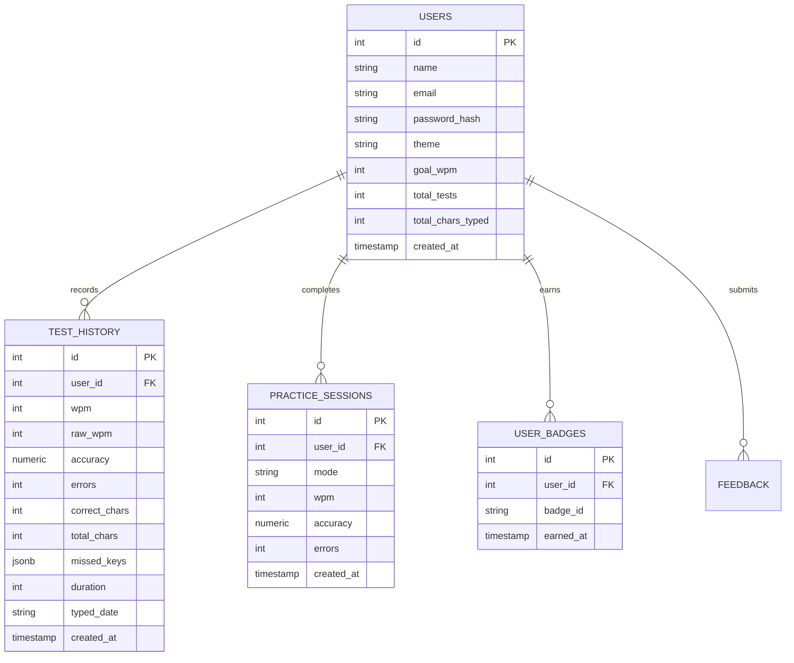

# ⚡ QuickType — Advanced Real-Time Typing Speed & Accuracy Platform

<p align="center">
  
</p>

<p align="center">
  <a href="https://quicktype-app.vercel.app"></a>
  <a href="https://github.com/ISHAN9173/QUICK-TYPER"></a>
  
  
  
  
</p>

---

## 🌟 Overview

**QuickType** is an enterprise-grade, full-stack typing evaluation and training web application designed to help developers, students, and professionals elevate their keyboard cadence, precision, and endurance. 

Featuring real-time metrics, dynamic auditory keystroke synthesis, automated achievement certification, and a live PostgreSQL analytics pipeline, QuickType transforms typing drills into an engaging, gamified experience.

* **Live Deployment:** [https://quicktype-app.vercel.app](https://quicktype-app.vercel.app)
* **Custom Domain:** [https://ishan-quicktype.vercel.app](https://ishan-quicktype.vercel.app)
* **Author:** Ishan Prajapati (ID: `2410112090`)
* **Course:** Web Application Development (WAD)

---

## ✨ Key Features

- ⚡ **Precision Real-Time Typing Engine:** Computes instantaneous WPM, net speed, character-level accuracy percentage, and total errors calculated down to the millisecond.
- 🔊 **Web Audio Keystroke Synthesis:** High-fidelity click feedback for tactile immersion and Web Speech API speech synthesis integration.
- 📊 **Live PostgreSQL Analytics:** Instant reverse-chronological test history tracking, personal best records, and historical averages.
- 🏆 **Automated Certificate Generation:** Dynamically renders an official printable Certificate of Achievement with verification details upon test completion.
- 🤖 **AI-Powered Typing Coach:** Diagnostic engine that analyzes missed keys and recommends tailored practice routines.
- 🎯 **Interactive Ergonomic Image Carousel:** Auto-sliding mechanical keyboard photography showcase with smooth fade transitions.
- 🔥 **Streak & Badge Rewards System:** Motivates daily deliberate practice with unlockable badges and streak milestones.
- 🛡️ **Universal Laptop Failover:** Zero-config automated store ensures the application runs out-of-the-box on any computer even without a pre-configured database.

---

## 🛠️ Technology Stack

| Layer | Technologies Used |
| :--- | :--- |
| **Frontend** | React.js 18, CSS3 Modern Flex/Grid, HTML5 Canvas Confetti, Web Speech API |
| **Backend** | Node.js, Express.js REST API, JSON Web Tokens (JWT), Bcrypt password hashing |
| **Database** | PostgreSQL (`quicktype_db`), Connection Pool (`pg`), Schema Migrations, MySQL compatible |
| **Deployment** | Vercel Serverless Functions, Git CI/CD pipeline |
| **Tooling** | Playwright Core, MinGit, PowerShell Automation |

---

## 📂 Project Directory Structure

```text
QUICK-TYPER/
├── api/                    # Vercel cloud serverless API functions
│   └── index.js            # Unified serverless backend handler
├── docs/                   # Documentation & social release assets
│   ├── LINKEDIN_POST.md    # LinkedIn launch post writeup
│   └── LOCAL_SETUP.md      # Detailed deployment & configuration manual
├── public/                 # HTML templates, web manifest & static icons
├── scripts/                # Automated batch execution & testing scripts
│   ├── run_all.bat         # Master 1-click synchronized service launcher
│   ├── start_website.bat   # Dual-service starter (Ports 3000 & 5000)
│   ├── view_postgres_live.bat # Real-time PostgreSQL CLI data inspector
│   ├── setup_database.bat  # Automated database & schema creator
│   ├── reset_previous_data.bat # Clear test history for clean re-tests
│   ├── install_dependencies.bat # 1-click package installer
│   └── record_simulation.js # HD video recording automation
├── server/                 # Express backend server (Local & Self-Hosted)
│   ├── db/
│   │   ├── pool.js         # Smart connection pool with failover store
│   │   ├── schema.sql      # Clean PostgreSQL database schema
│   │   └── mysql_schema.sql# MySQL schema fallback
│   ├── routes/             # REST endpoints (auth, history, practice, users)
│   └── index.js            # Express server initialization
├── src/                    # Frontend React source code
│   ├── components/         # Navbar, Footer, interactive modals
│   ├── constants/          # Static drills, badges & carousel slides
│   ├── lib/                # API client communication layer
│   ├── pages/              # 13 React views (Home, Tests, Progress, Certificate, etc.)
│   ├── utils/              # Audio synthesis & confetti physics
│   ├── App.css             # Responsive styling & themes
│   └── App.jsx             # Core application state & routing
├── RUN.bat                 # Root 1-click execution shortcut
├── package.json            # Frontend dependencies & npm scripts
└── vercel.json             # Vercel deployment configuration
```

---

## 🚀 Quick Start (Run in 1 Go)

### Option 1: One-Click Runner (Windows)
Double-click **`RUN.bat`** in the project root. It automatically:
1. Verifies and installs missing npm packages.
2. Synchronizes PostgreSQL tables in `quicktype_db`.
3. Launches the Node.js backend on `http://localhost:5000`.
4. Opens the live terminal database monitor.
5. Launches the React app on `http://localhost:3000` and opens your default browser!

---

### Option 2: Manual Terminal Setup

#### 1. Clone the repository:
```bash
git clone https://github.com/ISHAN9173/QUICK-TYPER.git
cd QUICK-TYPER
```

#### 2. Install dependencies:
```bash
# Frontend
npm install

# Backend
cd server
npm install
cd ..
```

#### 3. Setup PostgreSQL Database:
Ensure PostgreSQL is running locally, then initialize the database tables:
```bash
node server/apply_schema.js
```

#### 4. Run the applications:
```bash
# Terminal 1: Backend Server (Port 5000)
cd server
node index.js

# Terminal 2: React Frontend (Port 3000)
npm start
```

---

## 🗄️ PostgreSQL Database Schema



---

## 📡 Core API Reference

| Method | Endpoint | Description |
| :--- | :--- | :--- |
| `POST` | `/api/auth/register` | Register new user account |
| `POST` | `/api/auth/login` | Authenticate and issue user profile |
| `GET` | `/api/history/:userId` | Retrieve recent 30 typing test records |
| `POST` | `/api/history` | Log a newly completed typing test |
| `POST` | `/api/practice` | Save targeted key practice drill session |
| `PATCH` | `/api/users/:id` | Update profile settings, goals, or streaks |
| `GET` | `/api/health` | Service health status & database connectivity |

---

## 👨‍💻 Author & Academic Attribution

* **Developer:** Ishan Prajapati
* **Student ID:** 2410112090
* **Course:** Web Application Development (WAD)
* **GitHub:** [@ISHAN9173](https://github.com/ISHAN9173)
* **Live Deployment:** [quicktype-app.vercel.app](https://quicktype-app.vercel.app)

---

## 📄 License
This project is licensed under the [MIT License](LICENSE).
